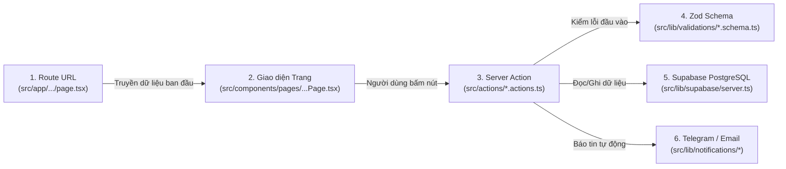

# QUY CHUẨN CẤU TRÚC CODEBASE — DỰ ÁN MAI ĐINH SPA

> **Mục đích tài liệu:** Quy định thống nhất cấu trúc thư mục, vai trò của từng file, quy ước đặt tên và luồng kết nối giữa các tầng trong toàn bộ dự án **Mai Đinh Spa**.  
> **Tài liệu liên quan:** [MDS.md](./MDS.md) (Đặc tả Nghiệp vụ & Thiết kế Database)

---

## 1. Ba Nguyên tắc Kiến trúc Bắt buộc

1. **Một Codebase Fullstack Duy nhất (`source/`):**
   - Không tách rời project Backend riêng. Toàn bộ Giao diện (Frontend), Xử lý nghiệp vụ ngầm (Server Actions / API Routes) và Kết nối Database (Supabase) nằm chung trong thư mục `source/`.
2. **Mô hình Thin Route (`app/` mỏng — `components/pages/` chứa giao diện):**
   - Thư mục `src/app/` **chỉ** dùng để khai báo đường dẫn URL, cấu hình tiêu đề SEO (`metadata`) và truyền dữ liệu ban đầu. Tuyệt đối không viết giao diện phức tạp hay state dài dòng trong `src/app/`.
   - **100% giao diện của các trang** phải đặt tập trung tại `src/components/pages/` với tên file rõ ràng theo từng phân hệ (`public`, `auth`, `member`, `admin`).
3. **Phân tách rõ Code chạy trên Server và Trình duyệt:**
   - Các file tương tác giao diện dùng `useState`, `useEffect`, sự kiện `onClick`/`onSubmit` đặt chỉ thị `'use client'` ở dòng đầu tiên.
   - Các file xử lý nghiệp vụ nhạy cảm (lưu Database, tính điểm thành viên, gọi Telegram/Resend) đặt trong `src/actions/` với chỉ thị `'use server'` ở dòng đầu tiên để bảo mật tuyệt đối trên máy chủ.

---

## 2. Sơ đồ Cây Thư mục Toàn Dự án

```text
MaiDinhSpa/
├── documents/                                     # TÀI LIỆU DỰ ÁN
│   ├── MDS.md                                     # Đặc tả nghiệp vụ, Tech Stack & Database Schema
│   └── codebase.md                                # Quy chuẩn cấu trúc toàn bộ codebase (file này)
│
└── source/                                        # MÃ NGUỒN ỨNG DỤNG NEXT.JS FULLSTACK
    ├── supabase/                                  # QUẢN LÝ CƠ SỞ DỮ LIỆU SQL
    │   ├── schema.sql                             # Script tạo 9 bảng, Index, RLS & Transaction cộng điểm
    │   └── seed.sql                               # Dữ liệu khởi tạo (4 Hạng thành viên, Dịch vụ & Mỹ phẩm mẫu)
    │
    ├── public/                                    # TÀI NGUYÊN TĨNH CÔNG KHAI
    │   ├── images/                                # Logo Mai Đinh Spa, ảnh Hero, ảnh không gian tĩnh
    │   └── favicon.ico                            # Biểu tượng tab trình duyệt
    │
    ├── src/
    │   ├── middleware.ts                          # Cổng kiểm soát phiên đăng nhập & chặn quyền vào /admin
    │   │
    │   ├── app/                                   # TẦNG 1: ĐỊNH TUYẾN URL & SEO (THIN ROUTES)
    │   │   ├── globals.css                        # Khai báo Tailwind CSS & biến màu thương hiệu Spa
    │   │   ├── layout.tsx                         # Root Layout (Font chữ tiếng Việt, Provider thông báo Toast)
    │   │   ├── not-found.tsx                      # Giao diện khi truy cập sai đường dẫn (404)
    │   │   │
    │   │   ├── (public)/                          # Nhóm URL công khai cho Khách hàng
    │   │   │   ├── layout.tsx                     # Bọc sẵn Navbar + Nút Zalo nổi + Footer
    │   │   │   ├── page.tsx                       # URL: /                 -> gọi HomePage
    │   │   │   ├── dich-vu/
    │   │   │   │   ├── page.tsx                   # URL: /dich-vu          -> gọi ServicesPage
    │   │   │   │   └── [slug]/page.tsx            # URL: /dich-vu/[slug]   -> gọi ServiceDetailPage
    │   │   │   ├── san-pham/
    │   │   │   │   ├── page.tsx                   # URL: /san-pham         -> gọi ProductsPage
    │   │   │   │   └── [slug]/page.tsx            # URL: /san-pham/[slug]  -> gọi ProductDetailPage
    │   │   │   ├── dat-lich/
    │   │   │   │   └── page.tsx                   # URL: /dat-lich         -> gọi BookingPage
    │   │   │   └── tra-cuu-lich/
    │   │   │       └── page.tsx                   # URL: /tra-cuu-lich     -> gọi BookingLookupPage
    │   │   │
    │   │   ├── (auth)/                            # Nhóm URL Xác thực tài khoản
    │   │   │   ├── layout.tsx                     # Khung giao diện đăng nhập tối giản
    │   │   │   ├── dang-nhap/page.tsx             # URL: /dang-nhap        -> gọi LoginPage
    │   │   │   ├── dang-ky/page.tsx               # URL: /dang-ky          -> gọi RegisterPage
    │   │   │   └── cap-nhat-sdt/page.tsx          # URL: /cap-nhat-sdt     -> gọi UpdatePhonePage
    │   │   │
    │   │   ├── tai-khoan/                         # Nhóm URL Thành viên thân thiết (Yêu cầu đăng nhập)
    │   │   │   ├── layout.tsx                     # Bọc sẵn Menu tài khoản thành viên
    │   │   │   ├── page.tsx                       # URL: /tai-khoan        -> gọi MemberDashboardPage
    │   │   │   ├── lich-hen/page.tsx              # URL: /tai-khoan/lich-hen     -> gọi MemberBookingsPage
    │   │   │   └── lich-su-diem/page.tsx          # URL: /tai-khoan/lich-su-diem -> gọi PointHistoryPage
    │   │   │
    │   │   ├── admin/                             # Nhóm URL Quản trị Chủ Spa (Chỉ role ADMIN được vào)
    │   │   │   ├── layout.tsx                     # Bọc sẵn AdminSidebar + Thanh thông tin Chủ Spa
    │   │   │   ├── page.tsx                       # URL: /admin            -> gọi AdminDashboardPage
    │   │   │   ├── lich-hen/page.tsx              # URL: /admin/lich-hen   -> gọi AdminBookingsPage
    │   │   │   ├── khach-hang/page.tsx            # URL: /admin/khach-hang -> gọi AdminCustomersPage
    │   │   │   ├── dich-vu/page.tsx               # URL: /admin/dich-vu    -> gọi AdminServicesPage
    │   │   │   ├── san-pham/page.tsx              # URL: /admin/san-pham   -> gọi AdminProductsPage
    │   │   │   └── cai-dat/page.tsx               # URL: /admin/cai-dat    -> gọi AdminSettingsPage
    │   │   │
    │   │   └── api/                               # Nhóm HTTP Endpoints đặc biệt
    │   │       ├── auth/callback/route.ts         # Xử lý Google OAuth redirect về từ Supabase
    │   │       └── upload/route.ts                # Nhận file ảnh từ Admin đẩy lên Cloudinary
    │   │
    │   ├── components/                            # TẦNG 2: TOÀN BỘ GIAO DIỆN REACT (UI LAYER)
    │   │   ├── pages/                             # [QUAN TRỌNG] Chứa 100% giao diện hoàn chỉnh của các trang
    │   │   │   ├── public/
    │   │   │   │   ├── HomePage.tsx               # Landing Page (Hero, Giới thiệu, Dịch vụ & Mỹ phẩm nổi bật)
    │   │   │   │   ├── ServicesPage.tsx           # Danh sách & bộ lọc nhóm Dịch vụ
    │   │   │   │   ├── ServiceDetailPage.tsx      # Chi tiết Dịch vụ, thời lượng, quy trình & CTA đặt lịch
    │   │   │   │   ├── ProductsPage.tsx           # Danh mục Mỹ phẩm trưng bày (Không giỏ hàng)
    │   │   │   │   ├── ProductDetailPage.tsx      # Chi tiết Mỹ phẩm, thành phần & nút tư vấn Zalo
    │   │   │   │   ├── BookingPage.tsx            # Màn hình chọn Dịch vụ, Ngày giờ & Gửi yêu cầu chờ duyệt
    │   │   │   │   └── BookingLookupPage.tsx      # Màn hình tra cứu trạng thái lịch hẹn bằng SĐT + Mã đơn
    │   │   │   ├── auth/
    │   │   │   │   ├── LoginPage.tsx              # Giao diện Đăng nhập (Google & Email)
    │   │   │   │   ├── RegisterPage.tsx           # Giao diện Đăng ký tài khoản mới
    │   │   │   │   └── UpdatePhonePage.tsx        # Giao diện bổ sung SĐT & Ngày sinh lần đầu
    │   │   │   ├── member/
    │   │   │   │   ├── MemberDashboardPage.tsx    # Thẻ thành viên điện tử, Hạng, Tiến trình lên hạng & Điểm
    │   │   │   │   ├── MemberBookingsPage.tsx     # Lịch sử các lần hẹn tại Spa & Nút xin hủy lịch chờ duyệt
    │   │   │   │   └── PointHistoryPage.tsx       # Bảng lịch sử cộng điểm / tiêu điểm chi tiết
    │   │   │   └── admin/
    │   │   │       ├── AdminDashboardPage.tsx     # Thống kê nhanh: Lịch chờ duyệt, Lịch hôm nay, Doanh thu
    │   │   │       ├── AdminBookingsPage.tsx      # Quản lý duyệt lịch, đổi giờ, bấm Hoàn thành & Tích điểm
    │   │   │       ├── AdminCustomersPage.tsx     # Hồ sơ khách hàng, Ghi chú da, Điều chỉnh/Trừ điểm tại quầy
    │   │   │       ├── AdminServicesPage.tsx      # Bảng thêm / sửa / ẩn hiện Dịch vụ
    │   │   │       ├── AdminProductsPage.tsx      # Bảng thêm / sửa / ẩn hiện Sản phẩm trưng bày
    │   │   │       └── AdminSettingsPage.tsx      # Cài đặt Giờ mở cửa, Tỷ lệ tích điểm & Cấu hình 4 Hạng
    │   │   │
    │   │   ├── layout/                            # Các khung bố cục cố định dùng chung
    │   │   │   ├── Navbar.tsx                     # Thanh điều hướng khách hàng (Desktop & Mobile Menu)
    │   │   │   ├── Footer.tsx                     # Chân trang (Địa chỉ Mai Đinh Spa, Bản đồ, Giờ mở cửa)
    │   │   │   ├── FloatingContact.tsx            # Nút gọi Hotline / Chat Zalo nổi góc màn hình
    │   │   │   ├── MemberSidebar.tsx              # Thanh điều hướng khu vực Thành viên
    │   │   │   └── AdminSidebar.tsx               # Thanh điều hướng khu vực Chủ Spa
    │   │   │
    │   │   ├── shared/                            # Các khối giao diện nghiệp vụ tái sử dụng ở nhiều trang
    │   │   │   ├── ServiceCard.tsx                # Thẻ hiển thị 1 Dịch vụ (dùng ở cả HomePage & ServicesPage)
    │   │   │   ├── ProductCard.tsx                # Thẻ hiển thị 1 Sản phẩm (dùng ở cả HomePage & ProductsPage)
    │   │   │   ├── MembershipTierBadge.tsx        # Nhãn hiển thị Hạng (Member / Bạc / Vàng / Kim Cương)
    │   │   │   ├── BookingStatusBadge.tsx         # Nhãn trạng thái lịch (Chờ duyệt / Đã xác nhận / Hoàn thành...)
    │   │   │   └── CheckoutLoyaltyModal.tsx       # Popup chốt tiền thực thu, trừ điểm & cộng điểm cho Chủ Spa
    │   │   │
    │   │   └── ui/                                # Các thành phần giao diện nguyên tử từ shadcn/ui
    │   │       ├── button.tsx
    │   │       ├── input.tsx
    │   │       ├── textarea.tsx
    │   │       ├── select.tsx
    │   │       ├── dialog.tsx
    │   │       ├── calendar.tsx
    │   │       ├── badge.tsx
    │   │       └── table.tsx
    │   │
    │   ├── actions/                               # TẦNG 3: XỬ LÝ NGHIỆP VỤ SERVER ('use server')
    │   │   ├── auth.actions.ts                    # Đăng ký, Đăng nhập, Đăng xuất, Gắn SĐT đồng bộ khách cũ
    │   │   ├── booking.actions.ts                 # Tạo lịch PENDING + Báo Telegram; Duyệt/Hủy lịch + Báo Email
    │   │   ├── loyalty.actions.ts                 # Chốt hóa đơn thực thu, ghi sổ cái điểm & xét thăng hạng
    │   │   ├── customer.actions.ts                # Tra cứu khách hàng, cập nhật ghi chú da, điều chỉnh điểm tay
    │   │   ├── catalog.actions.ts                 # CRUD Danh mục, Dịch vụ, Sản phẩm trưng bày
    │   │   └── settings.actions.ts                # Đọc & Cập nhật cấu hình giờ mở cửa, công thức tích điểm
    │   │
    │   ├── lib/                                   # TẦNG 4: KẾT NỐI HẠ TẦNG & TIỆN ÍCH NỀN
    │   │   ├── supabase/
    │   │   │   ├── client.ts                      # Supabase Client dùng cho Client Components
    │   │   │   ├── server.ts                      # Supabase Client dùng cho Server Components & Actions
    │   │   │   └── admin.ts                       # Supabase Service Role (chỉ dùng nội bộ trên Server khi cần)
    │   │   ├── validations/                       # Bộ quy tắc kiểm tra dữ liệu đầu vào bằng Zod
    │   │   │   ├── auth.schema.ts                 # Kiểm tra Email, Mật khẩu, định dạng SĐT Việt Nam (10 số)
    │   │   │   ├── booking.schema.ts              # Kiểm tra chọn dịch vụ, ngày hẹn hợp lệ, khung giờ mở cửa
    │   │   │   └── catalog.schema.ts              # Kiểm tra giá tiền, thời lượng dịch vụ, thông tin sản phẩm
    │   │   ├── notifications/
    │   │   │   ├── telegram.ts                    # Hàm định dạng và bắn tin nhắn về Telegram Chủ Spa
    │   │   │   └── email.ts                       # Hàm gửi Email xác nhận lịch hẹn & điểm thưởng qua Resend
    │   │   ├── cloudinary.ts                      # Cấu hình kết nối Cloudinary lưu trữ & nén ảnh WebP
    │   │   ├── constants.ts                       # Hằng số toàn cục (Trạng thái lịch hẹn, Mã hạng mặc định)
    │   │   └── utils.ts                           # Hàm tiện ích: formatCurrency (VNĐ), formatDate, cn()
    │   │
    │   └── types/                                 # TẦNG 5: ĐỊNH NGHĨA KIỂU TYPESCRIPT
    │       ├── database.types.ts                  # Kiểu dữ liệu ánh xạ trực tiếp từ 9 bảng Supabase
    │       └── index.ts                           # Kiểu dữ liệu mở rộng dùng cho Props & Action Response
    │
    ├── .env.example                               # Danh sách mẫu các biến môi trường cần điền
    ├── .env.local                                 # Biến môi trường thật trên máy cá nhân (Git bỏ qua file này)
    ├── .gitignore                                 # Danh sách file không đẩy lên GitHub
    ├── components.json                            # Cấu hình thư viện giao diện shadcn/ui
    ├── next.config.ts                             # Cấu hình Next.js (cho phép domain ảnh Cloudinary)
    ├── postcss.config.mjs                         # Cấu hình biên dịch Tailwind CSS
    ├── tsconfig.json                              # Cấu hình TypeScript & đường dẫn tắt @/* -> ./src/*
    └── package.json                               # Quản lý thư viện và scripts khởi chạy dự án
```

---

## 3. Bảng Ánh xạ Đường dẫn URL ↔ File Route ↔ File Giao diện

Bảng dưới đây quy định chính xác khi muốn sửa màn hình nào thì mở file nào trong `src/components/pages/`:

| Phân hệ | Đường dẫn trên Trình duyệt | File Định tuyến (`src/app/...`) | File Giao diện Chính (`src/components/pages/...`) | Quyền truy cập |
| :--- | :--- | :--- | :--- | :--- |
| **Khách** | `/` | `(public)/page.tsx` | `public/HomePage.tsx` | Công khai |
| **Khách** | `/dich-vu` | `(public)/dich-vu/page.tsx` | `public/ServicesPage.tsx` | Công khai |
| **Khách** | `/dich-vu/[slug]` | `(public)/dich-vu/[slug]/page.tsx` | `public/ServiceDetailPage.tsx` | Công khai |
| **Khách** | `/san-pham` | `(public)/san-pham/page.tsx` | `public/ProductsPage.tsx` | Công khai |
| **Khách** | `/san-pham/[slug]` | `(public)/san-pham/[slug]/page.tsx` | `public/ProductDetailPage.tsx` | Công khai |
| **Khách** | `/dat-lich` | `(public)/dat-lich/page.tsx` | `public/BookingPage.tsx` | Công khai |
| **Khách** | `/tra-cuu-lich` | `(public)/tra-cuu-lich/page.tsx` | `public/BookingLookupPage.tsx` | Công khai |
| **Auth** | `/dang-nhap` | `(auth)/dang-nhap/page.tsx` | `auth/LoginPage.tsx` | Khách chưa đăng nhập |
| **Auth** | `/dang-ky` | `(auth)/dang-ky/page.tsx` | `auth/RegisterPage.tsx` | Khách chưa đăng nhập |
| **Auth** | `/cap-nhat-sdt` | `(auth)/cap-nhat-sdt/page.tsx` | `auth/UpdatePhonePage.tsx` | Đã đăng nhập (thiếu SĐT) |
| **Member** | `/tai-khoan` | `tai-khoan/page.tsx` | `member/MemberDashboardPage.tsx` | Thành viên đã đăng nhập |
| **Member** | `/tai-khoan/lich-hen` | `tai-khoan/lich-hen/page.tsx` | `member/MemberBookingsPage.tsx` | Thành viên đã đăng nhập |
| **Member** | `/tai-khoan/lich-su-diem` | `tai-khoan/lich-su-diem/page.tsx` | `member/PointHistoryPage.tsx` | Thành viên đã đăng nhập |
| **Admin** | `/admin` | `admin/page.tsx` | `admin/AdminDashboardPage.tsx` | Chỉ `ADMIN` (Chủ Spa) |
| **Admin** | `/admin/lich-hen` | `admin/lich-hen/page.tsx` | `admin/AdminBookingsPage.tsx` | Chỉ `ADMIN` (Chủ Spa) |
| **Admin** | `/admin/khach-hang` | `admin/khach-hang/page.tsx` | `admin/AdminCustomersPage.tsx` | Chỉ `ADMIN` (Chủ Spa) |
| **Admin** | `/admin/dich-vu` | `admin/dich-vu/page.tsx` | `admin/AdminServicesPage.tsx` | Chỉ `ADMIN` (Chủ Spa) |
| **Admin** | `/admin/san-pham` | `admin/san-pham/page.tsx` | `admin/AdminProductsPage.tsx` | Chỉ `ADMIN` (Chủ Spa) |
| **Admin** | `/admin/cai-dat` | `admin/cai-dat/page.tsx` | `admin/AdminSettingsPage.tsx` | Chỉ `ADMIN` (Chủ Spa) |

---

## 4. Quy định Chi tiết cho Từng Thư mục

### 4.1. Quy tắc trong `src/components/`
Để tránh phình to một file hoặc đặt nhầm vị trí component, tuân thủ 4 cấp sau:
1. **`components/ui/`**: Chỉ chứa các thành phần giao diện gốc của `shadcn/ui` (không gắn logic nghiệp vụ của Spa vào đây).
2. **`components/layout/`**: Chỉ chứa khung bao ngoài cố định của trang (Navbar, Footer, Sidebar).
3. **`components/shared/`**: Khi một khối giao diện xuất hiện ở **từ 2 trang trở lên** (ví dụ `ServiceCard` vừa hiện ở Trang chủ vừa hiện ở Trang Dịch vụ), tách nó ra đặt vào `shared/`.
4. **`components/pages/`**: Mỗi trang lớn tương ứng đúng 1 file `*Page.tsx`. Nếu 1 trang quá dài (trên 250 dòng), có thể tách các section con đặt cạnh nó hoặc đưa vào `shared/`.

### 4.2. Quy tắc trong `src/actions/` (Tầng Backend Ngầm)
Mọi hàm ghi/sửa/xóa dữ liệu đều phải viết tại `src/actions/*.actions.ts` và tuân thủ quy trình 4 bước:
1. **Kiểm tra quyền (Auth Check):** Các hàm của Chủ Spa (duyệt lịch, cộng điểm, sửa giá) bắt buộc kiểm tra `user.role === 'ADMIN'` đầu tiên.
2. **Kiểm tra dữ liệu (Zod Validation):** Đưa dữ liệu đầu vào qua schema tương ứng trong `src/lib/validations/`.
3. **Thực thi Database & Tác vụ phụ:** Lưu vào Supabase; nếu thành công mới bắn tin nhắn Telegram / gửi Email.
4. **Trả về kết quả thống nhất (`ActionResponse`):** Không quăng lỗi thô ra giao diện mà trả về định dạng chuẩn:
   ```ts
   type ActionResponse<T = void> = {
     success: boolean;
     message?: string;
     data?: T;
   };
   ```

---

## 5. Quy ước Đặt tên & Import (Coding Conventions)

| Thành phần | Quy ước đặt tên | Ví dụ chuẩn | Ví dụ sai (Không dùng) |
| :--- | :--- | :--- | :--- |
| **Thư mục đường dẫn (`src/app/`)** | `kebab-case` (chữ thường, gạch ngang) | `lich-su-diem/`, `dat-lich/` | `LichSuDiem/`, `dat_lich/` |
| **Giao diện Trang (`components/pages/`)** | `PascalCase` + hậu tố `Page.tsx` | `HomePage.tsx`, `BookingPage.tsx` | `home.tsx`, `booking-page.tsx` |
| **Component dùng chung (`shared/`, `layout/`)** | `PascalCase.tsx` | `ServiceCard.tsx`, `Navbar.tsx` | `serviceCard.tsx`, `navbar.tsx` |
| **Server Actions (`src/actions/`)** | `camelCase` + hậu tố `.actions.ts` | `booking.actions.ts`, `loyalty.actions.ts` | `BookingAction.ts`, `loyalty.ts` |
| **Zod Validation (`src/lib/validations/`)** | `camelCase` + hậu tố `.schema.ts` | `booking.schema.ts`, `auth.schema.ts` | `validateBooking.ts` |
| **Đường dẫn Import trong code** | Luôn dùng bí danh tuyệt đối `@/` | `import Navbar from '@/components/layout/Navbar'` | `import Navbar from '../../../components/layout/Navbar'` |

---

## 6. Mẫu Luồng Code Chuẩn cho 1 Tính năng

Khi phát triển bất kỳ màn hình mới nào trong dự án, luồng gọi luôn đi một chiều sạch sẽ như sau:


